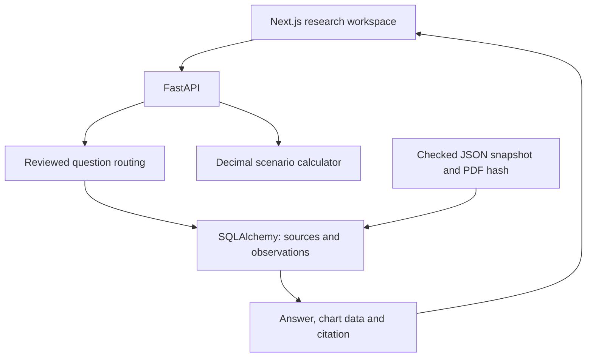

# Architecture and implementation boundaries

## Current vertical slice

The Next.js application sends same-origin `/api/*` requests through a server rewrite to FastAPI. FastAPI queries SQLAlchemy models for reviewed sources, evidence summaries and observations. SQLite provides a zero-configuration local path; PostgreSQL is supported by the same relational model and a Compose service.

The reviewed JSON snapshot is a version-controlled publication artifact. Startup checks the original PDF hash and publishes its source, 52 observations and three manually reviewed summaries in one transaction. Repeating publication is idempotent. SQLAlchemy `create_all` is used for this first schema; it is not a migration system.

Research routing is deterministic. It recognizes a narrow set of numerical intents, explicitly resolves available dates and refuses unsupported requests. It returns an answer, source metadata and typed chart rows from the database. The frontend renders rates and index points separately. Numeric deltas use Decimal and percentage-point units. The calculator uses Decimal throughout, rounds money only at the response boundary, and exposes assumptions.

The CLI ingestion path is separate from publication. It stages local PDFs and extraction metadata by content hash. Scanned or incomplete text requires OCR and human review. It never replaces serving evidence merely because a parser completed.

## Next: retrieval and generation

1. Add Alembic migrations and explicit corpus publication versions before changing the schema in a deployed environment.
2. Curate 20–30 official reports with full provenance and checked section/page mappings. Add OCR/table extraction with review queues.
3. Build a held-out benchmark of answerable, unanswerable, numerical, source-conflict and freshness questions.
4. Compare lexical retrieval with hybrid lexical/vector retrieval in PostgreSQL plus pgvector. Publish measured retrieval recall and latency before selecting embedding/reranking models.
5. Add a provider adapter for grounded generation. Validate numeric claims and citation locations against retrieved evidence before returning answers. Preserve refusal behavior and token/cost limits.
6. Add authenticated user accounts, per-user saved research, authorization tests, rate limits, TLS, observability and scheduled discovery before a public hosted pilot.

No embeddings, pgvector search, reranker, model gateway, Redis/Celery queue or hosted accounts are implemented in this milestone. The name AI describes the project direction; the current chat is an evidence baseline.

## Operations and data rules

- Keep original source bytes, release date, review date, definition, unit, period and physical PDF page together.
- Do not combine CCPI and NCPI, base years, frequencies, nominal/real measures or annual-average/year-on-year inflation without an explicit transformation.
- A missing period remains missing. Never interpolate an official observation silently.
- Define freshness per source. Current coverage labels are historical; no successful daily refresh is implied.
- Public source code is distinct from public service deployment. Compose exposes only the web interface on localhost; no external deployment is created here.
- Saved research contains local snapshots in browser storage. There is no user identity or synchronization guarantee.

Team: Akinda Gunarathne and Sachin Gimahana. Independent project, with no university or official-institution affiliation implied.
